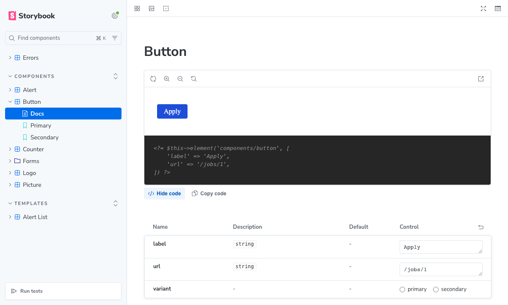
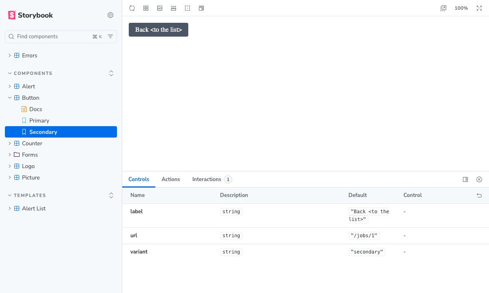
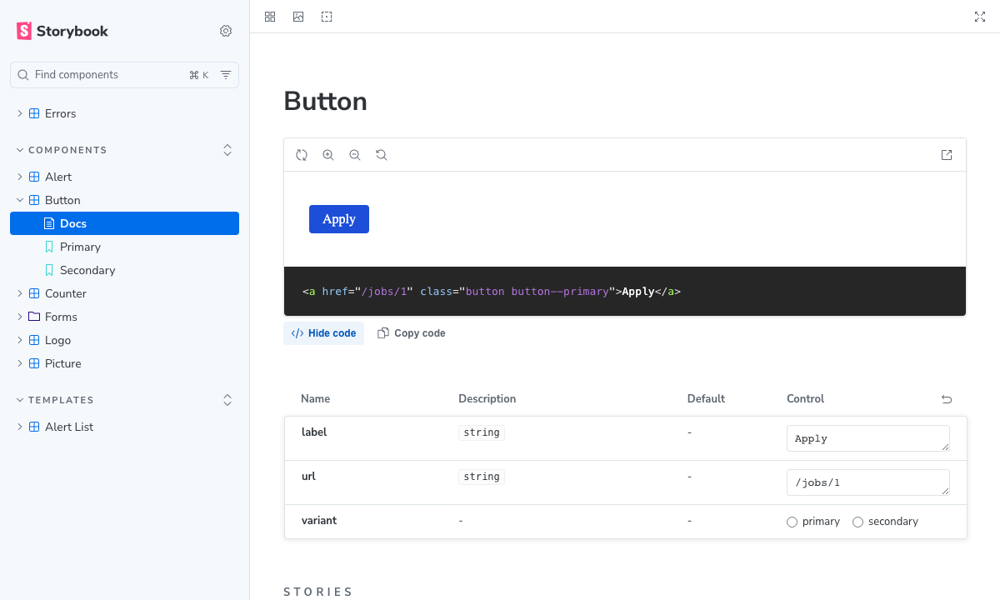

# Storybook Documentation

pieceofcake2/storybook renders the Elements of a CakePHP 2 application in
[Storybook](https://storybook.js.org/). It is inspired by
[Storybook for Symfony](https://github.com/sensiolabs/StorybookBundle). It consists of a CakePHP
plugin, which provides the render endpoint, and a Storybook framework
(`@pieceofcake2/storybook`, Vite builder), which is included in the Composer package.

> [!IMPORTANT]
> This plugin is for development only. Install it as a dev dependency (`composer require --dev`),
> and never install it in production. The render endpoint works only in debug mode
> (`debug` >= 1): run the application in debug mode for Storybook. See
> [Keeping Storybook out of Production](#production).

- [How It Works](#how-it-works)
- [Requirements](#requirements)
- [Installation](#installation)
- [Configuration](#configuration)
- [Writing Stories](#writing-stories)
- [Running Storybook Locally](#running-storybook-locally)
- [The Vite Config of the Application](#vite-config)
- [Publishing a Static Storybook](#static-build)
- [Keeping Storybook out of Production](#production)
- [Security](#security)
- [Testing Stories](#testing-stories)
- [Limitations](#limitations)

<a id="how-it-works"></a>

## How It Works

A story names an Element, and its args become the variables of the Element:

```ts
// stories/components/button.stories.ts
export default { component: 'components/button' };

export const Primary = { args: { label: 'Apply', url: '/jobs/1' } };
```

To render the story, the Storybook preview sends the name of the Element and the args to the
application:

```http
POST /_storybook/render/components-button--primary
Content-Type: application/json

{"element": "components/button", "args": {"label": "Apply", "url": "/jobs/1"}}
```

The application renders the Element with its View class and helpers, as
`$this->element('components/button', ['label' => 'Apply', 'url' => '/jobs/1'])` would, and
returns the HTML fragment. The preview puts it in the canvas and runs its scripts.


Only the name of an Element (under the allowed directories) and the args are sent: templates and
code are never received from the client, since PHP templates cannot be sandboxed. Stories that
combine several Elements use templates on the server, selected by name (see
[Story templates](#story-templates)).

In `storybook dev`, the Vite dev server of Storybook proxies `/_storybook/render` to the
application, which runs in debug mode. To publish Storybook, the stories are pre-rendered into a
static build, which does not need the application (see
[Publishing a Static Storybook](#static-build)).

<a id="requirements"></a>

## Requirements

- PHP 8.0+ and pieceofcake2/cakephp 2.13+
- Node.js 20.19+, Storybook 10 and Vite 5 to 8
- To publish a static Storybook: `playwright-core` and Chrome or Chromium (see
  [Publishing a Static Storybook](#static-build))

<a id="installation"></a>

## Installation

1. **Install the plugin as a dev dependency** with [Composer](https://getcomposer.org/):

   ```bash
   composer require --dev pieceofcake2/storybook
   ```

   The plugin has the `cakephp-plugin` type, so it is installed into your plugins directory by
   `composer/installers` (set `installer-paths` in your application's `composer.json`):

   | Layout | `installer-paths` | Path of the plugin |
   | --- | --- | --- |
   | Modern (`config/`, `src/`, `templates/`, `plugins/`) | `"plugins/{$name}/": ["type:cakephp-plugin"]` | `plugins/Storybook/` |
   | Legacy (`app/Config/`, `app/Plugin/`) | `"app/Plugin/{$name}/": ["type:cakephp-plugin"]` | `app/Plugin/Storybook/` |

   Do not install it as a regular dependency: production is deployed with
   `composer install --no-dev`, so that the plugin is not installed there. A published Storybook
   is pre-rendered where the dev dependencies are installed (e.g. in CI), so the environment where
   it is deployed does not need the plugin (see [Publishing a Static Storybook](#static-build)).

2. **Load the plugin with its routes** in `config/bootstrap.php` (legacy layout:
   `app/Config/bootstrap.php`), only when it is installed:

   ```php
   try {
       CakePlugin::load('Storybook', ['routes' => true]);
   } catch (MissingPluginException) {
       // Not installed (composer install --no-dev)
   }
   ```

   With `CakePlugin::loadAll()`, pass the option for the plugin:
   `CakePlugin::loadAll(['Storybook' => ['routes' => true]]);`. `loadAll()` loads only the
   plugins found in the plugins directories, so it does not fail when the plugin is not
   installed. It reads the list of plugins from the `_cake_core_` cache when it exists: clear the
   cache when you deploy (as after any change of the plugins).

   Loading the plugin with `'routes' => true` connects the render route
   (`/_storybook/render/:story`), in debug mode only (`Configure::read('debug')` >= 1). With
   `debug` 0, the route is not connected, and the controller also returns 404 (in case debug mode
   is turned off after the routes are loaded).

   Your `config/routes.php` must call `CakePlugin::routes()` (as the default one does).

3. **Install Storybook and the framework** with npm. The framework is not published to npm: install
   it from the plugin directory with a `file:` dependency (adjust the path to where Composer
   installed the plugin):

   ```bash
   npm install --save-dev storybook@^10 vite @storybook/addon-docs \
       @pieceofcake2/storybook@file:plugins/Storybook/storybook
   ```

   ```json
   {
       "devDependencies": {
           "@pieceofcake2/storybook": "file:plugins/Storybook/storybook",
           "@storybook/addon-docs": "^10.6.2",
           "storybook": "^10.6.2",
           "vite": "^8.3.4"
       }
   }
   ```

   The built files of the framework are included in the package, so no build step is needed. Run
   `npm install` again after updating the plugin with Composer.

   If your npm configuration sets `ignore-scripts=true`, Storybook works without the install
   scripts.

   `npm ci` also works where the plugin is not installed (e.g. in the build of production): npm
   links the `file:` dependency, and the link is only used by Storybook.

<a id="configuration"></a>

## Configuration

### CakePHP

All settings are written in `config/bootstrap.php` (before loading the plugin), under the
`Storybook` key:

```php
Configure::write('Storybook', [
    // Element directories that stories can render (Elements/components/ by default)
    'elements' => ['components'],
    // Directory of the story templates under the view path (templates/Stories/), or false
    'templates' => 'Stories',
    // View settings. By default, those of AppController ($viewClass, $helpers, $ext, $theme)
    'viewClass' => null,
    'helpers' => null,
    'ext' => null,
    'theme' => null,
    // Whether PHP warnings and notices (e.g. an undefined variable) make the rendering fail
    'errorsAsExceptions' => true,
    // Classes that change the args before the rendering (see Args processors)
    'argsProcessors' => [],
]);
```

The controller extends `Controller`, not `AppController`: the components of your application
(Security, Session, Auth, ...) and the callbacks of `AppController` (e.g. `beforeFilter()`) are
not used for the render requests, so they are not subject to the CSRF and form tampering checks
of the Security component, and do not start a session. Only the view settings of `AppController`
are read (without instantiating it), so that Elements are rendered by the same View class (e.g.
`AppView`) with the same helpers and `h()` as in the application. Set `Storybook.helpers` if a
helper needs something that only exists in a normal request.

### Storybook

`.storybook/main.ts`:

```ts
import type { StorybookConfig } from '@pieceofcake2/storybook';

const config: StorybookConfig = {
    stories: ['../stories/**/*.stories.ts'],
    addons: ['@storybook/addon-docs'],
    framework: {
        name: '@pieceofcake2/storybook',
        options: {
            // URL of the CakePHP application, to which storybook dev proxies the render requests
            server: 'http://localhost:8765',
            // Other paths to proxy to the application (images, built assets, ...)
            proxyPaths: ['/img', '/build'],
            // Reload the stories when the templates change
            watchPaths: ['templates'],
        },
    },
};

export default config;
```

| Option | Description |
| --- | --- |
| `server` | URL of the CakePHP application. `storybook dev` proxies `/_storybook/render` and `proxyPaths` to it, with the `X-Storybook-Proxy: true` header. Not used by `storybook build`. |
| `proxyPaths` | Other paths (a string or an array) to proxy to the application, e.g. the images and the files referred to by the HTML of the Elements. |
| `watchPaths` | Files or directories (relative to the project) whose changes reload the stories in `storybook dev`. |
| `excludeVitePlugins` | Names of the Vite plugins of your Vite config to remove in Storybook (default: `['hot-file']`). See [The Vite Config of the Application](#vite-config). |
| `builder` | Options of `@storybook/builder-vite`, e.g. `viteConfigPath`. |

`.storybook/preview.ts` loads the CSS and the JavaScript of the application, by importing the
entry of your assets. Vite processes it with your Vite config (Sass, aliases, ...), with HMR in
`storybook dev`:

```ts
import type { Preview } from '@pieceofcake2/storybook';

import '../assets/app.ts';

const preview: Preview = {
    tags: ['autodocs'],
};

export default preview;
```

After each render, the scripts in the HTML of the story are run and `DOMContentLoaded` is
dispatched again, so the scripts of the application that initialize the page on
`DOMContentLoaded` also run for each story. Scripts that run once when they are imported only run
for the first story: run them on `DOMContentLoaded` instead.

To add tags to the `<head>` of the preview (e.g. web fonts), use
[`.storybook/preview-head.html`](https://storybook.js.org/docs/configure/story-rendering).

If the application is not at the root of its origin (e.g. `App.base` is `/app`), set the URL of
the render endpoint in `.storybook/preview.ts`:

```ts
const preview: Preview = {
    parameters: {
        cakephp: { renderUrl: '/app/_storybook/render' },
    },
};
```

<a id="writing-stories"></a>

## Writing Stories

Stories are written in [CSF](https://storybook.js.org/docs/api/csf) (e.g.
`stories/components/page_header.stories.ts`). Set `component` to the name of the Element (under
`templates/Elements/`, without the extension); the args are the variables of the Element:

```ts
import type { Meta, StoryObj } from '@pieceofcake2/storybook';

const meta = {
    title: 'Components/Page Header',
    component: 'components/page_header',
    args: {
        theme: 'career',
        title: 'Career',
        crumbs: [['Jobs', '/career/jobs'], ['Front Office']],
        heading: 'Front Office',
    },
    argTypes: {
        theme: { control: 'select', options: ['fresh', 'career', 'rjet', 'finance', 'parttime', 'contact'] },
    },
} satisfies Meta;

export default meta;

type Story = StoryObj<typeof meta>;

export const Default: Story = {};

export const WithoutCrumbs: Story = {
    args: { crumbs: [] },
};
```

`StoryObj<typeof meta>` types the args of the stories with those of the meta (other args, e.g.
those of `argTypes`, are also allowed, since the variables of an Element are not typed).
`StoryObj<{ label: string }>` types them with an args type instead.

Names of Elements and templates match `[a-z0-9_/-]+` (lowercase, no `..`), and Elements must be
under one of the allowed directories (`components/` by default). Args are sent as JSON: strings,
numbers, booleans, `null`, arrays and objects (as PHP arrays). Dates are sent as ISO 8601 strings.

`element('components/button')` is the same as the string `'components/button'`.

<a id="story-templates"></a>

### Story templates

To show several Elements together (e.g. a list of cards, or an Element inside a layout), write a
template on the server under `templates/Stories/` and select it with `template()`:

```php
<?php
// templates/Stories/job_list.php
/**
 * @var AppView $this
 * @var array $jobs
 */
?>
<div class="l-container">
<?php foreach ($jobs as $job) { ?>
    <?= $this->element('components/job_card', ['job' => $job]) ?>
<?php } ?>
</div>
```

```ts
import { template, type Meta } from '@pieceofcake2/storybook';

export default {
    title: 'Pages/Job List',
    component: template('job_list'),
    args: { jobs: [{ id: 1, title: 'Front Office' }] },
} satisfies Meta;
```

The args are set as the view variables of the template, which is rendered without a layout. The
templates directory is set by `Storybook.templates`.

<a id="args-processors"></a>

### Args processors

Args are JSON values, but Elements often receive objects: entities, value objects, dates. Args
processors are classes of your application that change the args on the server, after the request
is validated and before the Element (or the story template) is rendered. The story still sends
JSON args, and the processor turns them into objects:

```php
<?php
// src/Lib/Storybook/UserArgsProcessor.php
class UserArgsProcessor implements StorybookArgsProcessor
{
    public function __invoke(StorybookArgs $args): void
    {
        // {"user": {"name": "Taro", "joined": "2021-10-01"}} becomes a User object
        if (is_array($args['user'])) {
            $args['user'] = User::fromArray($args['user']);
        }
        if (is_array($args['users'])) {
            $args['users'] = array_map([User::class, 'fromArray'], $args['users']);
        }
    }
}
```

```php
<?php
// templates/Elements/components/user_card.php
/**
 * @var AppView $this
 * @var User $user
 */
?>
<article class="user-card">
    <h2><?= h($user->name) ?></h2>
    <p>Since <?= h($user->joined->format('F Y')) ?></p>
</article>
```

```ts
export default {
    component: 'components/user_card',
    args: { user: { name: 'Taro Yamada', joined: '2021-10-01' } },
} satisfies Meta;
```

Register the processors in `Storybook.argsProcessors` (in `config/bootstrap.php`), by class name,
or with an array to scope them:

```php
Configure::write('Storybook.argsProcessors', [
    // All the stories
    'UserArgsProcessor',
    // Only the matching stories
    [
        'class' => 'JobArgsProcessor',
        'stories' => ['components-job-card--closed'], // Story IDs
        'elements' => ['components/job_card'],        // Names of Elements
        'templates' => ['job_list'],                  // Names of story templates
    ],
]);
```

- An entry without `stories`, `elements` and `templates` applies to every story. With some of
  them, it applies to the stories that match any of them: the story ID (as in the URL of the
  story, e.g. `components-job-card--closed`), the name of the Element of the request, or the name
  of its story template (not to the Elements rendered inside the template). The values are exact
  names (a string or an array of strings), without wildcards.
- The processors run in the order of the entries, so a processor can prepare the args for the
  next one (e.g. set default values that another one turns into objects).
- The classes are found with `App::className($class, 'Lib')`, as the other classes named in the
  configuration: a global or fully qualified class name loaded by Composer, e.g. with the classmap
  of `src/` of pieceofcake2/app, which also loads `src/Lib/Storybook/UserArgsProcessor.php` and
  `User` above, or `Plugin.ClassName`. They are instantiated without arguments, once per request.

`StorybookArgs` holds the args and the story being rendered:

| Method | Description |
| --- | --- |
| `$args['name']`, `get('name', $default = null)` | The value of an arg (null or `$default` if it is not set) |
| `$args['name'] = $value`, `set('name', $value)` | Sets an arg (any PHP value). The name must be a valid variable name, not `this` |
| `isset($args['name'])`, `has('name')` | Whether the arg is set (`isset()` is false for null, `has()` is true) |
| `unset($args['name'])`, `remove('name')` | Removes an arg |
| `merge(array $values, bool $override = false)` | Adds args. By default, the args that are already set are kept (to set default values); with `$override`, the values replace them |
| `toArray()`, `foreach`, `count()` | The args, the variables of the Element or of the template |
| `story()` | The story ID (an empty string if unknown) |
| `element()`, `template()` | The name of the Element, or of the story template (null for the other one) |

An exception thrown by a processor fails the story, as an error of the Element does: the
response is a 500 error with the message and the trace (or the status of an `HttpException`, e.g.
`NotFoundException`). PHP warnings and notices in the processors fail it too, with
`errorsAsExceptions`.

Processors also run when a static Storybook is pre-rendered, since the application renders the
stories then. "Show code" in Docs shows the JSON args sent by the story (e.g.
`'user' => ['name' => 'Taro Yamada', ...]`), not the objects built by the processors.

### Render functions

A story can return the Element (or the template) and the args from `render`:

```ts
export const Large: Story = {
    render: (args) => ({ element: 'components/button', args: { ...args, large: true } }),
};
```

### Actions

Function args (e.g. `fn()` or the `action` argTypes) are not sent to the server. They are bound to
the events of the elements whose `data-storybook-callbacks` attribute contains the name of the arg: with `data-storybook-callbacks="increment"`, the
`increment` event of the element calls the `increment` arg.

```php
<button type="button" data-storybook-callbacks="increment">+1</button>
```

```ts
import { fn } from 'storybook/test';

export default {
    component: 'components/counter',
    args: { increment: fn() },
};
```

To log DOM events without changing the Element, use the `withActions` decorator of Storybook with
the `actions.handles` parameter:

```ts
import { withActions } from 'storybook/actions/decorator';

export default {
    component: 'components/button',
    parameters: { actions: { handles: ['click a'] } },
    decorators: [withActions],
};
```

### Docs

With `@storybook/addon-docs`, "Show code" shows the PHP code that renders the story, e.g.
`<?= $this->element('components/button', ['label' => 'Apply', ...]) ?>`. In a pre-rendered
(static) Storybook, it shows the pre-rendered HTML instead (see
[Controls in a static Storybook](#static-controls)).



### Errors

When the application returns an error, the story is marked as failed and the error page is shown
in the canvas. The error page is HTML whose first line is a comment with the message
(`<!-- Element "components/missing" was not found. -->`), with the status:

| Status | Cause |
| --- | --- |
| 400 | Invalid JSON, invalid name of an Element or a template, args that are not an object |
| 404 | Element outside the allowed directories, missing Element or template |
| 405 | Not a POST request |
| 500 | Error while rendering or in an args processor, including PHP warnings when `errorsAsExceptions` is true, with the message and the trace |

<a id="running-storybook-locally"></a>

## Running Storybook Locally

Run the application in debug mode (with the dev dependencies installed), and `storybook dev`:

```bash
# Terminal 1: the CakePHP application
php -d opcache.revalidate_freq=0 -S localhost:8765 -t webroot webroot/index.php

# Terminal 2: Storybook
npx storybook dev -p 6006
```

Open http://localhost:6006. With `opcache.revalidate_freq=0`, the changes of the templates are
rendered at once (with the default of 2 seconds, a reload by `watchPaths` can render the previous
version). Any server can be used instead of `php -S` (Docker, symfony CLI, ...): set its URL in
`server`.

You can add scripts to your `package.json`:

```json
{
    "scripts": {
        "storybook": "storybook dev -p 6006",
        "build-storybook": "storybook build",
        "prerender-storybook": "storybook-cakephp prerender --server http://127.0.0.1:8765"
    }
}
```

<a id="vite-config"></a>

## The Vite Config of the Application

`@storybook/builder-vite` loads the Vite config of your project (`vite.config.ts`), so that the
assets are processed in the same way in Storybook. Some settings of the config of a CakePHP
application do not apply to Storybook:

- `base`, `build` (e.g. `build.rollupOptions.input`, `build.outDir`, `build.manifest`) and, in
  `storybook dev`, `server` (`origin`, `port`, `https`, ...) are replaced by the builder.
- The `hot-file` plugin of the [pieceofcake2/vite](https://github.com/pieceofcake2/vite)
  documentation writes `webroot/hot` and removes it when the process exits: in Storybook, it would
  remove the hot file of a running Vite dev server, so the application would stop loading its
  assets from it. The framework removes the plugins named in `excludeVitePlugins` (`['hot-file']`
  by default).

If your config has other plugins that must not run in Storybook, add their names to
`excludeVitePlugins`, or check `process.env.STORYBOOK`, which Storybook sets to `'true'`:

```ts
// vite.config.ts
export default defineConfig({
    plugins: process.env.STORYBOOK === 'true' ? [] : [hotFile('webroot/hot', devServerUrl)],
});
```

To use a different config file for Storybook, set `builder.viteConfigPath` in the framework
options.

<a id="static-build"></a>

## Publishing a Static Storybook

Stories are developed with `storybook dev` and the application running in debug mode (see
[Running Storybook Locally](#running-storybook-locally)). To publish Storybook, e.g. on a
development or staging server that runs with `debug` 0 and without this plugin, pre-render the
stories into a static build: the published Storybook loads the HTML of the stories from its own
files, and never requests the application.

Build Storybook, and pre-render it with the application running in debug mode (e.g. in CI, where
the dev dependencies are installed):

```bash
# The CakePHP application in debug mode, with the dev dependencies
php -S 127.0.0.1:8765 -t webroot webroot/index.php &

npx storybook build -o storybook-static
npx storybook-cakephp prerender --server http://127.0.0.1:8765 --dir storybook-static
```

`storybook-cakephp prerender` (a command of the framework) serves the build on a local port, and
opens every story of its `index.json` in a headless Chrome. It forwards the render requests of the
preview to the application (with the `X-Storybook-Proxy: true` header, as `storybook dev` does),
and writes the responses into `<dir>/cakephp-prerendered/<story id>.json`. Finally, it adds
`<meta name="storybook-cakephp-prerendered">` to `<dir>/iframe.html`: with it, the preview loads
the stories from `cakephp-prerendered/` relative to `iframe.html`, so the build works under any
path (e.g. https://dev.example.com/storybook/).

Since the stories are rendered by the built preview, the pre-rendered HTML is made from the args
exactly as the build computes them: the args of the meta and of the story, the render functions,
the args set by play functions, and the URLs of the assets imported by the stories
(`import photo from './photo.jpg'`), which point into the build. The URL where the build is
served is stored as a placeholder, and replaced with the URL of the deployed Storybook.

### Requirements

- [`playwright-core`](https://www.npmjs.com/package/playwright-core), an optional peer dependency
  of the framework, which downloads no browser: `npm install --save-dev playwright-core`
- Chrome or Chromium, set by `--browser`:

  | `--browser` | Browser |
  | --- | --- |
  | `chrome` (default) | The installed Google Chrome (GitHub-hosted runners have it) |
  | `msedge`, `chrome-beta`, ... | Other installed browsers ([channels](https://playwright.dev/docs/browsers) of Playwright) |
  | `chromium` | The Chromium of Playwright (`npx playwright install chromium`) |
  | A path (e.g. `/usr/bin/chromium`) | A Chrome or Chromium executable |

  The `STORYBOOK_CAKEPHP_BROWSER` environment variable sets the default.

### Options

| Option | Description |
| --- | --- |
| `--server <url>` | URL of the CakePHP application, running in debug mode (required) |
| `--dir <dir>` | Directory of the Storybook build (default: `storybook-static`) |
| `--browser <browser>` | Browser (default: `chrome`, see above) |
| `--concurrency <n>` | Number of stories rendered at the same time (default: 4) |
| `--timeout <ms>` | Timeout of a story (default: 30000) |

The command fails (exit status 1) when a story cannot be pre-rendered (e.g. it times out, it
throws an exception, or the render endpoint is not available because the application is not in
debug mode). Stories for which the application returns an error are pre-rendered with the error
page, as `storybook dev` shows them, and listed as warnings.

Before pre-rendering, the command checks that `--server` responds. Any HTTP response is enough,
including a redirect (e.g. to a login page) or an error: redirects are not followed, so a redirect
to `App.fullBaseUrl` that cannot be reached from the machine does not fail the check.

Run `storybook-cakephp prerender` after each `storybook build`, which replaces the directory. If
`npx storybook-cakephp` is not found after updating the plugin, run `npm install` again.

<a id="static-controls"></a>

### Controls in a static Storybook

The stories are pre-rendered with their own args, and a static Storybook cannot render other args.
Its controls are read-only: the Controls panel and the table of the args in Docs show the args
(their names, descriptions and types) without editors, and the value of each arg in the story in
the "Default" column (unless `table.defaultValue` is set in its `argTypes`). Long arrays and objects
are shown in a tooltip. The framework sets `control: false` for every arg when the build is
pre-rendered, so `storybook dev` keeps the editors.



The rest works as in `storybook dev`: the stories and the Docs show the pre-rendered HTML, its
scripts run, and play functions and actions (`data-storybook-callbacks`) work.

Since the args cannot be changed, "Show code" in Docs shows the pre-rendered HTML of the story (as
the application rendered it, not reformatted) instead of the PHP code. For args that were not
pre-rendered, it shows the PHP code.



If the args are still changed (e.g. by the `args` parameter of the URL), the canvas shows a notice
("This story cannot be rendered with these args") instead of the story. The args must also be the
same every time the stories are loaded: an arg such as `new Date()` differs between the
pre-rendering and the published Storybook, so the story shows the notice.

### Deployment

The pre-rendered build is static files: deploy it with the other static files of the environment,
e.g. under `/storybook/` of the development server (`npx storybook build -o webroot/storybook`,
with `webroot/storybook/` in `.gitignore`), or to the storage or CDN that serves the site. The
plugin is not needed there, so the environment can be deployed with `composer install --no-dev`
like production. The HTML of the Elements refers to the images and assets of the application
(e.g. `/img/logo.svg`) by their URLs: deploy Storybook on the same host as the application, so
that they are found.

For example, in GitHub Actions:

```yaml
- run: composer install --no-interaction
- run: npm ci
- name: Build and pre-render Storybook
  run: |
    php -d variables_order=EGPCS -S 127.0.0.1:8765 -t webroot webroot/index.php &
    npx storybook build -o storybook-static
    npx storybook-cakephp prerender --server http://127.0.0.1:8765 --dir storybook-static
  env:
    APP_DEBUG: 1 # However your application turns on debug mode
# Then upload storybook-static/ to /storybook/ of the development environment
```

> [!NOTE]
> By default, `php -S` does not put the environment variables into `$_ENV` and `$_SERVER`
> (`variables_order` has no `E`). With [symfony/dotenv](https://symfony.com/doc/current/components/dotenv.html)
> (e.g. in [pieceofcake2/app](https://github.com/pieceofcake2/app)), the values of the `.env` files
> (e.g. `config/.env.local` on a developer machine) are then used instead of variables such as
> `APP_DEBUG=1`. Run `php -d variables_order=EGPCS -S ...` when you pass environment variables to
> the application, also locally.

The application only has to render the Elements of the stories in CI: set up what they need (e.g.
a database, if the helpers or the Elements read from it).

A build that is not pre-rendered sends the render requests to `/_storybook/render` of its origin.
It works only on the same origin as an application in debug mode with the plugin (e.g. served by
the application locally).

<a id="production"></a>

## Keeping Storybook out of Production

The render endpoint renders any Element of the allowed directories with arbitrary args, which is
not meant for production. It works only in debug mode, and the plugin is a dev dependency, which
is not installed in production.

- Install the plugin with `composer require --dev`, and deploy production with
  `composer install --no-dev` and debug mode off. Check that `POST /_storybook/render/x` returns
  404 there.
- Publish Storybook as a pre-rendered build (see [Publishing a Static Storybook](#static-build)).
  Do not deploy it to production, or exclude it from the files deployed to production (e.g.
  `webroot/storybook/`).

<a id="security"></a>

## Security

- Only the name of an Element or of a story template, and the args are received. Templates and
  code are never received from the client, since PHP templates cannot be sandboxed.
- Names must match `[a-z0-9_/-]+` and cannot contain `..`, a leading `/`, a plugin prefix or an
  extension. Elements must be under the allowed directories (`Storybook.elements`), and templates
  under the templates directory (`Storybook.templates`, which can be disabled with false).
- The args must be a JSON object whose keys are valid PHP variable names (not `this`).
- Args processors are only the classes configured on the server (`Storybook.argsProcessors`):
  the request cannot name a class or a processor. They receive the args of the request, which
  anyone who can reach the endpoint can send: build objects from them as from any input (validate
  them, and do not use them to read or write data that the stories should not show).
- The endpoint exists only where the plugin is installed (a dev dependency, not installed in
  production), and only in debug mode (`debug` >= 1, otherwise 404). It accepts only POST
  requests, and returns `Cache-Control: no-store` and `X-Robots-Tag: noindex`. The messages and
  traces of server errors are shown, as in debug mode.
- The endpoint does not use the Security component (CSRF) or the session, since the requests come
  from Storybook without a form. Do not install it where the Elements could expose data to
  unauthorized users: Elements are rendered with the args of the request, and with whatever the
  helpers and the Elements read by themselves (configuration, database, ...).

<a id="testing-stories"></a>

## Testing Stories

Stories can be tested with [`@storybook/addon-vitest`](https://storybook.js.org/docs/writing-tests/integrations/vitest-addon)
(play functions, interactions and accessibility), with the application running: the framework
adds the same proxy to the Vite server of Vitest.

```ts
// vitest.config.ts
import { storybookTest } from '@storybook/addon-vitest/vitest-plugin';
import { playwright } from '@vitest/browser-playwright';
import { defineConfig } from 'vitest/config';

export default defineConfig({
    plugins: [storybookTest({ configDir: '.storybook' })],
    test: {
        browser: {
            enabled: true,
            headless: true,
            provider: playwright(),
            instances: [{ browser: 'chromium' }],
        },
    },
});
```

The repository of this package runs the stories of its test application in this way. It also
checks every story of the build served by the application, and of the pre-rendered build served
as static files with the application stopped (`tests/test_app/bin/e2e.sh`).

<a id="limitations"></a>

## Limitations

- Args are JSON values, so Elements that expect objects (e.g. entities or `DateTime`) need an
  [args processor](#args-processors) or a story template that builds them.
- The request is a POST request to `/_storybook/render`, so Elements that depend on the current
  request (URL, query, session, logged-in user) render with that request.
- A pre-rendered Storybook shows the stories with their own args only, with read-only controls
  (see [Controls in a static Storybook](#static-controls)).
- Element caching (the `cache` option of `element()`) and plugin Elements (`Plugin.name`) are not
  supported.
- The framework uses the Vite builder only (no Webpack).
